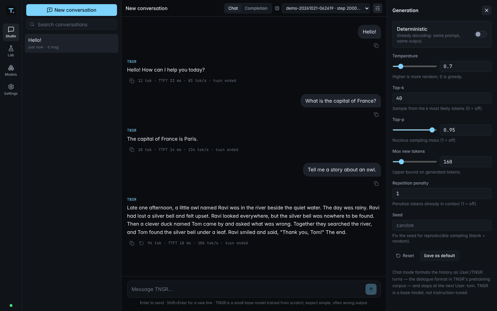
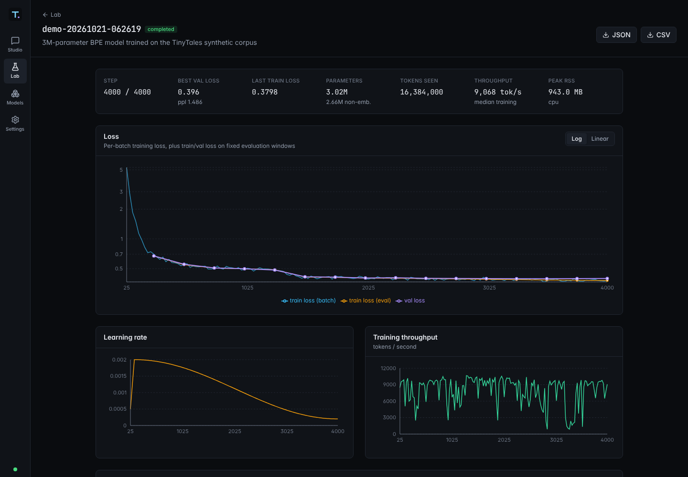
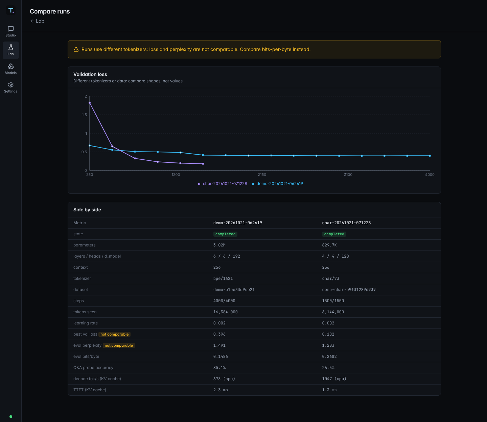

# TNSR

A from-scratch decoder-only Transformer language model, with everything around it:
tokenizers, a resumable training pipeline, a streaming inference engine, evaluation and
benchmarks (**TNSR Core**), an experiment dashboard (**TNSR Lab**) and a chat application
(**TNSR Studio**).

The primary model's weights are learned by TNSR's own training code. There is no pretrained
model, no Hugging Face Transformers and no external LLM API. Everything runs locally, and none
of it needs an API key.

| | |
|---|---|
| Model | GPT-style decoder: learned or rotary positions, RMSNorm/LayerNorm, causal multi-head attention (fused SDPA or explicit mask), GELU MLP, weight tying, KV cache |
| Tokenizers | character-level and byte-level BPE, both trained here, versioned and content-hashed |
| Data | deterministic, MIT-licensed synthetic corpus ("TinyTales") or your own `.txt`/`.md` files; leak-free document-level splits |
| Training | AdamW, warmup + cosine decay, clipping, grad accumulation, autocast, periodic eval, atomic checkpoints, bit-exact resume, graceful Ctrl+C, NaN detection |
| Inference | temperature, top-k, top-p, repetition penalty, greedy and seeded sampling, stop strings, EOS, UTF-8-safe streaming, TTFT and tokens/s |
| App | FastAPI + SQLite backend, SSE streaming with cancellation; React/TypeScript/Tailwind UI |



| Lab: run detail | Lab: comparing BPE and character models |
|---|---|
|  |  |

## Measured results

These come from runs on the development machine (Linux VM, 4 x86 cores, no GPU,
PyTorch 2.14 CPU). The run records are committed in [`releases/runs/`](releases/runs).

| | **demo** (BPE) | **char** |
|---|---|---|
| parameters | 3.02M (6 layers, 6 heads, d=192, context 256) | 0.83M (4 layers, 4 heads, d=128, context 256) |
| tokenizer | byte-level BPE, 1,621 tokens | 73 characters |
| training | 4,000 steps × 4,096 tokens = 16.4M tokens, 45.8 min¹ | 1,500 steps × 4,096 = 6.1M tokens, 5.6 min (interrupted at step 257, then resumed) |
| training throughput | ~9,000–10,000 tokens/s | ~25,000 tokens/s |
| val loss / perplexity² | 0.399 nats/token / 1.49 | 0.185 nats/char / 1.20 |
| **bits per byte**² | **0.149** | 0.268 |
| Q&A probe accuracy³ | **85.1%** (212/249) | 26.5% |
| decode speed, KV cache on / off⁴ | 673 / 213 tokens/s | 1,047 / 589 tokens/s |
| time to first token⁴ | 2.3 ms (16-token prompt), 6.3 ms (64) | 1.3 ms / 2.2 ms |
| peak process memory (inference) | 291 MB | 274 MB |

¹ Wall time includes periods where the CPU was shared with test runs; the undisturbed rate is
~9.5K tokens/s, or about 30 minutes.
² Full validation split (5% of documents, never seen in training). Perplexity is per token, so
it is **not comparable** between the two tokenizers; bits-per-byte is.
³ Exact match, greedy decoding, on 249 questions built from the corpus generator's tables.
Demo model per category: capitals, animal sounds, animal legs, colors, opposites, calendar,
spelling and counting at 100%; addition 28/50 and subtraction 15/30, mostly off by one. These
facts appear in the training data, so this measures what the model learned, not general
knowledge.
⁴ Greedy decoding, 64 new tokens, median of 5 runs. The KV cache gives a 3.0–3.2× decode speedup.

Sample from the demo model (Studio, chat mode, temperature 0.7):

```
User: Tell me a story about an owl.
TNSR: Late one afternoon, a little owl named Ravi was in the river beside the quiet water. The
day was rainy. Ravi had lost a silver bell and felt upset. Ravi looked everywhere, but the
silver bell was nowhere to be found. Then a clever duck named Tom came by and asked what was
wrong. Together they searched the river, and Tom found the silver bell under a leaf. Ravi
smiled and said, "Thank you, Tom!" The end.
```

**Limitations.** This is a 3M-parameter **base model** trained on a small templated corpus. It
reproduces the corpus's formats very well and its facts mostly well, gets arithmetic wrong about
half the time, and has no knowledge beyond the corpus. Chat works because about 45% of the
corpus is `User:`/`TNSR:` dialogue (see [ADR 0002](docs/decisions/0002-chat-on-a-base-model.md)).
TNSR is not instruction-tuned.

### On Apple Silicon

Measured on the owner's Apple Silicon MacBook Air (PyTorch MPS backend):

| | Apple GPU (MPS) | CPU |
|---|---|---|
| training throughput, demo model (4,096-token batches) | **~33–35K tok/s** | ~21–22K tok/s |
| generation, char model, KV cache on | ~850 tok/s | **~3,000 tok/s** |
| time to first token, char model | ~1.1 ms | **~0.5–0.7 ms** |

MPS and CPU training produced identical losses (5.7358 at step 20 of the smoke run). So TNSR
**trains on MPS and generates on the CPU** by default: with `device = "auto"`, models under
50M parameters are served from the CPU, because per-token GPU launch overhead dominates at
this size. Set `TNSR_DEVICE=mps` or pass `--device mps` to override. Extrapolating the smoke run's ~34K tokens/s,
the full demo run should take roughly 8 minutes there (not yet measured end to end).

## Quickstart

Requirements: Python 3.10–3.13, [uv](https://docs.astral.sh/uv/), Node.js 20+ (only to build
the UI). Works on macOS (Apple Silicon uses Metal/MPS automatically), Linux and CPU-only
machines.

```bash
git clone <this repo> tnsr && cd tnsr
uv sync --extra dev            # Python deps (pinned in uv.lock; Linux gets the CPU PyTorch wheel)
npm install                    # UI deps (pinned in package-lock.json)
uv run tnsr doctor             # environment diagnostics

# Option A: use the trained models committed in releases/ (seconds)
bash scripts/restore_release.sh

# Option B: train your own from scratch
uv run tnsr data prepare       # synthetic corpus → datasets/demo
uv run tnsr train --config demo                # ~30 min on 4 CPU cores; Ctrl+C saves a checkpoint

npm run build                  # build the UI once
uv run tnsr serve              # http://127.0.0.1:8000  (Studio, Lab, Models, Settings)
```

`scripts/quickstart.sh` does install → doctor → data → train → evaluate → benchmark → build in
one go (`--quick` trains a small model in a few minutes instead).

For UI development, run `npm run dev`. It starts the API with auto-reload on :8000 and Vite on
http://127.0.0.1:5173.

## Using TNSR

### Command line

```bash
uv run tnsr doctor                                  # Python/PyTorch/device/memory/disk checks + smoke test
uv run tnsr data prepare [--name N] [--source synthetic|PATH] [--tokenizer bpe|char] [--vocab-size V]
uv run tnsr data inspect demo                       # stats, provenance, license, decoded sample
uv run tnsr train --config demo [--set train.learning_rate=1e-3 ...] [--smoke]
uv run tnsr train --resume <run-id> [--max-steps N]
uv run tnsr generate [MODEL] -p "Once upon a time" [--temperature 0.8 --top-k 40 --top-p 0.95 --seed 1]
uv run tnsr generate --chat -p "What sound does a cow make?" --deterministic
uv run tnsr evaluate [MODEL]                        # loss, perplexity, bits/byte, probes, samples
uv run tnsr benchmark [MODEL]                       # TTFT, tokens/s with/without KV cache, memory
uv run tnsr models list | show | export | import
uv run tnsr runs list
uv run tnsr serve [--port 8000]
```

`MODEL` is a checkpoint id, a run id (meaning that run's best checkpoint) or a path. If you
leave it out, TNSR uses the newest best checkpoint.

### TNSR Studio

- Conversations persist in SQLite. The sidebar has new, search, rename and delete.
- Tokens stream in as they are generated. You can stop, retry the last response, or copy any
  message. Enter sends and Shift+Enter adds a new line.
- **Chat mode** formats the history as `User:`/`TNSR:` turns. **Completion mode** continues
  your text as written.
- The header has a model picker and a backend status indicator. The generation panel has
  validated controls for temperature, top-k, top-p, max tokens, repetition penalty,
  deterministic (greedy) decoding, seed and ignore end-of-text. You can save the current values
  as defaults.
- Every response reports its token count, time to first token, tokens/s and why it stopped.

### TNSR Lab

- An experiments table with live progress and ETA. Start new runs from presets, stop them (a
  checkpoint is saved) and resume them, including runs started from the CLI.
- Each run has charts for loss (log or linear scale), learning rate and throughput. It also
  shows the checkpoints (each with Evaluate and Benchmark actions), evaluation results with
  probes and samples, benchmarks, model and training config, and the environment
  (Python/PyTorch versions, device, git commit).
- The compare view puts several runs side by side and warns when metrics are not comparable
  (different tokenizer, validation text or device).
- Runs export as JSON (everything) or CSV (metrics). Datasets show their provenance and license,
  and you can prepare new synthetic datasets from here.

## Architecture

```
tnsr_core/     tokenizer/ model/ data/ training/ inference/ evaluation/ checkpoints/ config/ cli.py
tnsr_server/   app.py, api/ (routes, schemas), services/ (models, generation, jobs, experiments), persistence/
tnsr_ui/       React app: src/lib (API client, SSE), hooks, pages (Studio, Lab, Models, Settings), components
tests/         pytest: unit, server, real-server integration, slow
scripts/       test.sh, e2e.sh, quickstart.sh, export_artifacts.sh, restore_release.sh
docs/          architecture, training, evaluation, troubleshooting, roadmap, decisions/, progress
```

Training and inference share the model code and checkpoint format, but inference loads only
`model.pt`, `meta.json` and `tokenizer.json`. It never needs the dataset or the optimizer state.
Training, evaluation and benchmarks run as subprocesses, so chat stays responsive while a model
trains. See [docs/architecture.md](docs/architecture.md).

Generated artifacts are kept out of git:

| path | contents |
|---|---|
| `datasets/<name>/` | `train.bin`, `val.bin`, `tokenizer.json`, `meta.json` |
| `experiments/<run>/` | `run.json`, `status.json`, `metrics.jsonl`, `checkpoints/step_N/`, `evals/`, `benchmarks/` |
| `checkpoints/<name>/` | imported checkpoints |
| `var/` | `tnsr.db` (conversations, settings, jobs, experiment index), `jobs/*.log` |

Set `TNSR_HOME` to keep artifacts somewhere else (see `.env.example`).

## Checkpoints and preserving work

- Checkpoints are written atomically and never overwritten. TNSR keeps the most recent
  `keep_checkpoints` plus the best one.
- `uv run tnsr models export <run|checkpoint> model.tar.gz [--include-train-state]` and
  `uv run tnsr models import model.tar.gz --name mymodel` (the archive is validated before use).
- `scripts/export_artifacts.sh` bundles every run's best checkpoint, its metrics, evaluations
  and benchmarks, dataset metadata and tokenizers, and a consistent copy of the SQLite
  database into `exports/`.
- Loading a checkpoint checks its format version, that all files are present, that the tokenizer
  identity and vocabulary size match, and that the weights fit the architecture. Missing or
  deleted checkpoints produce clear errors in the CLI, API and UI.

## Data and licensing

The bundled corpus is generated by [`tnsr_core/data/synthetic.py`](tnsr_core/data/synthetic.py)
and contains no third-party text, so it is MIT-licensed like the rest of the repository. It mixes
short stories, fact paragraphs (animal facts, colors, capitals, opposites) and dialogues
(greetings, arithmetic computed by the generator, counting, calendar, spelling, stories).

To train on your own text, run `uv run tnsr data prepare --name mine --source path/to/texts`.
Only use text you have the right to train on. TNSR doesn't download datasets.

## Tests

```bash
scripts/test.sh               # ruff, mypy, pytest (fast suite), eslint, tsc, vitest
scripts/test.sh --slow --e2e  # also longer training tests and the full-stack browser test
```

| suite | count | what it covers |
|---|---|---|
| pytest (default) | 126 | tokenizers, model (shapes, causal masking, SDPA vs. manual, KV cache, gradients, overfitting), data (splits, leakage), training (smoke, bit-exact resume, interrupt, NaN abort, rotation, invalid configs, device fallback), inference (sampling, EOS, stop strings, determinism, cancellation, checkpoint compatibility), CLI, API (validation, SSE, cancel, retry, persistence, jobs incl. stop/resume), real uvicorn server (streaming, client-disconnect cancellation) |
| pytest `-m slow` | 2 | a small model learns the corpus (val loss, bits/byte); KV cache is faster |
| vitest | 32 | SSE parser, API errors, settings validation, composer, messages, generation panel, sidebar, full Studio flows against a mocked backend |
| Playwright (`scripts/e2e.sh`) | 1 | trains a tiny model from scratch, serves it, and checks in Chromium that tokens stream in incrementally, stop works, conversations survive a reload, renames stick and the Lab shows the run |

## Documentation

- [Architecture](docs/architecture.md): components, data flow, checkpoint format, concurrency, streaming protocol
- [Training](docs/training.md): datasets, presets, resuming, reliability, hardware notes
- [Evaluation](docs/evaluation.md): metrics, comparability, benchmarks, profiling
- [Troubleshooting](docs/troubleshooting.md): installation, Apple Silicon, training, server and UI issues
- [Roadmap](docs/roadmap.md): done vs planned (e.g. instruction fine-tuning)
- [Decisions](docs/decisions/) and [progress log](docs/progress.md)

## License

MIT.
